# Multimodal CRC MSI Prediction — Hybrid Android–Backend System

A multimodal research prototype for colorectal cancer microsatellite instability (MSI-H vs. MSS) prediction combining histopathology image tile features and clinical pathology reports, using Android-based edge interaction and Python workstation backend inference.

---

## 1. Project Title and Overview

**Repository:** `multimodal-crc-msi-hybrid`  
**Display Title:** Multimodal CRC MSI Prediction — Hybrid Android–Backend System  
**System Architecture:** Hybrid Architecture B (Edge Mobile Client + Workstation Inference Backend)

This project implements an investigational multimodal deep learning system designed to predict Microsatellite Instability (MSI-H) and Microsatellite Stable (MSS) phenotypes in Colorectal Cancer (CRC). The pipeline integrates two distinct diagnostic modalities:
1. **Histopathology Visual Features:** Extracted from Hematoxylin and Eosin (H&E) stained whole-slide tissue tiles using the self-supervised vision transformer **Phikon-v2** (`owkin/phikon-v2`, ViT-L/16, 1024-D).
2. **Clinical Pathology Narrative:** Extracted from unstructured surgical pathology reports using **Bio_ClinicalBERT** (`emilyalsentzer/Bio_ClinicalBERT`, 768-D).

The modalities are dynamically integrated using a learnable **Summary-to-Patch Cross-Attention** module (`SummaryToPatchCrossAttention`, 5.25M parameters) where the clinical narrative embedding acts as a global semantic query attending over variable-length sequences of visual patch keys and values.

The system is deployed as a **Hybrid Architecture**:
- **Mobile Client:** Native Android application written in Kotlin and Jetpack Compose running on edge mobile hardware (tested on Samsung Galaxy S24, Android 14 / API 34), providing specimen metadata entry, local tile folder ingestion, batch base64 transmission, real-time prediction rendering, attention-based tile ranking, cellular attention heatmaps, and on-device vector PDF report generation.
- **Inference Backend:** Python Flask REST service (`src/api/inference_api.py`) hosted on a local workstation, executing transformer embeddings, cross-attention fusion, and an optional local LLM clinical scribe (via Ollama).

---

## 2. Project Status and Version

| Parameter | Specification |
| :--- | :--- |
| **Current Release** | `v1.0.0` (Initial Research Release) |
| **Release Artifact** | `Multimodal-CRC-Hybrid-v1.0.0.apk` (16.8 MB) |
| **APK Package ID** | `com.cancerdetection.multimodal.research.debug` |
| **Target SDK / Min SDK** | Android SDK 34 (Android 14) / Min SDK 26 (Android 8.0) |
| **Trained Checkpoint** | `models/fusion_model_v1_1.pth` (20.03 MB, 5,250,561 parameters) |
| **Classification Threshold** | $\tau = 0.83$ (Conservative clinical decision boundary) |
| **Validation Cohort** | $N = 66$ TCGA-COAD patients (50 MSS, 16 MSI-H) |
| **Operating Environment** | Windows 10/11 64-bit, Python 3.11, PyTorch 2.9.1+cpu |
| **Operational Status** | Research prototype; investigational use only |

---

## 3. Actual Application Screenshots

The following screenshots illustrate the end-to-end clinical research workflow on a mobile device:

| Step 1: Research Case Overview | Step 2: Specimen & Clinical Input | Step 3: Analysis Findings & Probability | Step 4: Attention-Ranked Tiles |
| :---: | :---: | :---: | :---: |
| 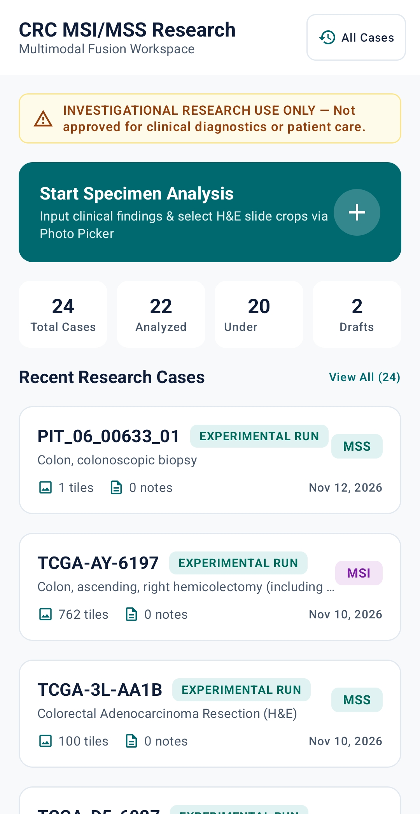 | 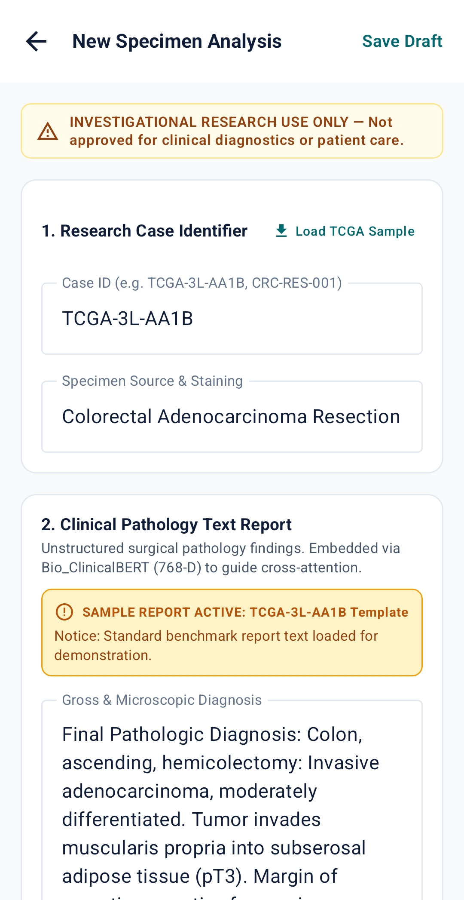 | 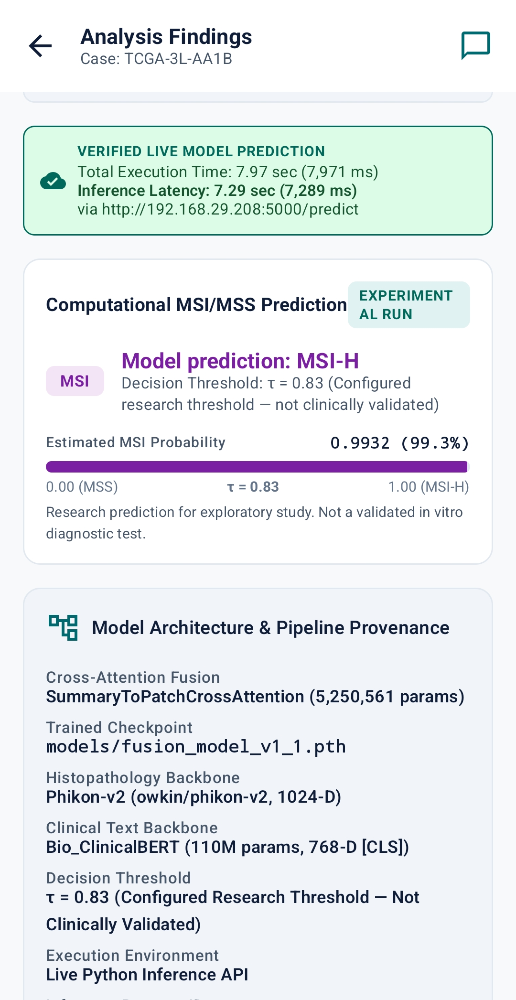 | 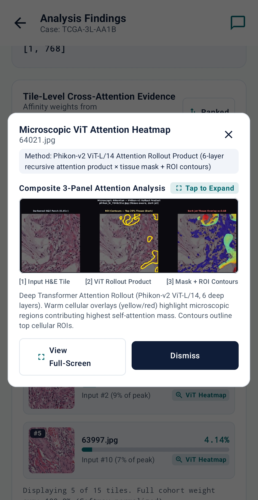 |
| *Study list, server status, and case initiation* | *Case ID, clinical report text, tile selector, and backend URL* | *MSI-H prediction, probability (0.9227), and threshold marker* | *Patch-level cross-attention ranking and ViT heatmap dialog* |

| Step 5: Report Preview Action | Step 6: Case TCGA-AY-6197 Cross-Attention | Step 7: AI Scribe Summary (Case Overview) | Step 8: AI Scribe (Clinical Findings) |
| :---: | :---: | :---: | :---: |
| 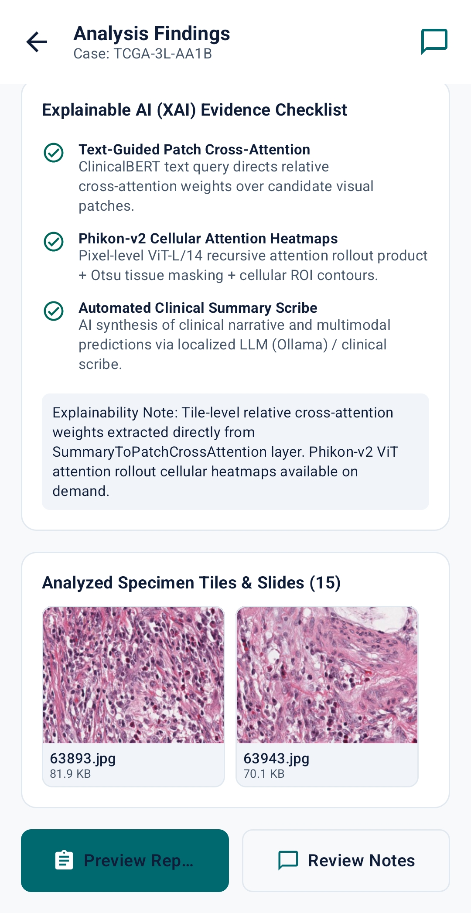 | 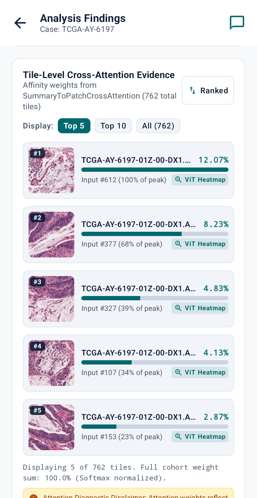 | 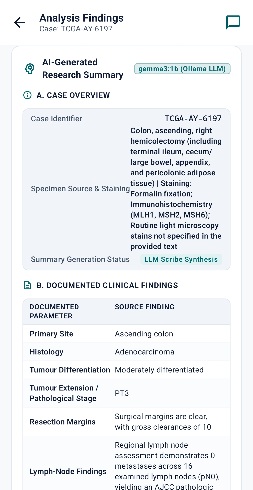 | 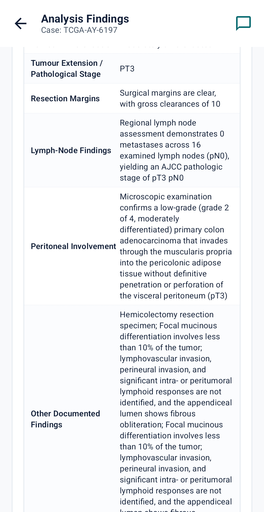 |
| *On-device PDF generation trigger and sharing controls* | *Tile-level cross-attention weights for demonstration case* | *Structured case metadata generated via Ollama LLM* | *Extracted histologic parameters: stage, margins, and nodes* |

| Step 9: AI Scribe (Prediction Scribe) | Step 10: On-Device PDF Preview |
| :---: | :---: |
| 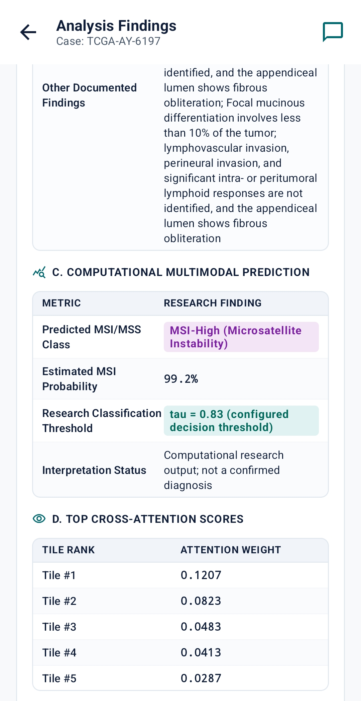 | 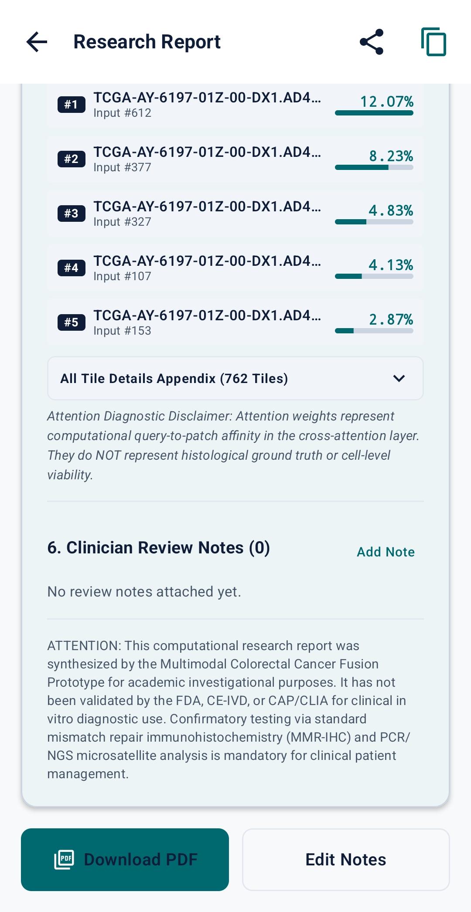 |
| *Computational MSI probability documentation and disclaimer* | *Final structured clinical report preview prior to export* |

---

## 4. Research Problem and Motivation

Microsatellite Instability (MSI) resulting from defective DNA mismatch repair (dMMR) occurs in approximately 15% of colorectal carcinomas. Determining MSI status is clinically imperative:
1. **Immunotherapy Indication:** MSI-H patients exhibit high neoantigen loads and demonstrate substantial responsiveness to Immune Checkpoint Inhibitors (ICIs) such as Pembrolizumab and Nivolumab.
2. **Chemotherapy Prognosis:** Patients with Stage II MSI-H tumors do not benefit from adjuvant 5-Fluorouracil (5-FU) fluoropyrimidine monotherapy and may experience adverse outcomes.
3. **Screening for Lynch Syndrome:** Identification of MSI-H triggers genetic evaluation for germline mismatch repair gene mutations.

Conventional diagnostic determination relies on Immunohistochemistry (IHC) for MMR proteins (MLH1, MSH2, MSH6, PMS2) or Polymerase Chain Reaction (PCR) molecular fragment analysis. However, molecular testing is resource-intensive, requires specialized molecular pathology infrastructure, takes days to weeks, and incurs significant financial cost. 

Computational prediction directly from digitized Hematoxylin and Eosin (H&E) whole-slide histology images offers rapid pre-screening. However, purely visual models frequently suffer from false positives due to histological mimics (e.g., medullary architecture, mucinous differentiation, prominent tumor-infiltrating lymphocytes). Combining visual features with structured clinical pathology findings (anatomic site, histologic differentiation, patient stage) disambiguates borderline histological presentations.

---

## 5. Objectives and Scope

### Primary Objectives
- **Multimodal Integration:** Jointly process patch-level visual histology features and unstructured surgical pathology narratives using cross-attention.
- **Conservative Decision Boundary:** Calibrate classification thresholds to prioritize high specificity ($\ge 90\%$) and high positive predictive value, preventing false-positive MSI assignments.
- **Edge Clinical Workflow:** Provide pathologists with an intuitive, mobile-accessible edge tool for case triage, interactive visual explanation, and automated reporting.
- **Separation of Concerns:** Maintain a clean client-server architecture where heavy foundation models execute on dedicated workstation compute while the edge device manages user interaction and display.

### Scope Boundaries
- **Investigational Use Only:** This system is an academic research prototype and has not received FDA clearance or CE-IVD mark as an in vitro diagnostic medical device.
- **Input Pre-requisites:** Whole-slide histology must be pre-extracted into $224 \times 224$ tiles at $10\times$ equivalent optical magnification prior to folder ingestion. Direct multi-gigabyte `.svs` streaming on mobile devices is not implemented.

---

## 6. System Architecture

The end-to-end system consists of two primary runtime tiers communicating over standard HTTP REST protocols on a local area network (LAN):

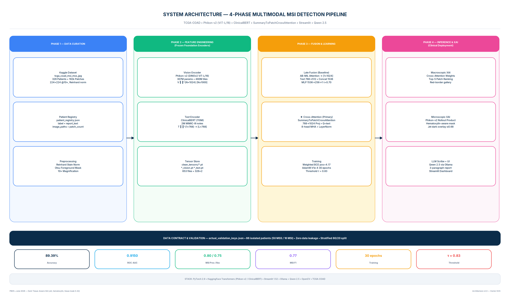

### Communication and Data Flow
```
[ Samsung Galaxy S24 Mobile App ]
      │
      ├─ 1. Case Metadata & Clinical Narrative Input
      ├─ 2. H&E Tile Folder Ingestion (ARGB_8888, 224x224 JPEG Q=90)
      │
      ▼ (HTTP POST /embed_tiles in 25-tile chunks)
[ Workstation Flask REST API (Port 5000) ]
      │
      ├─ 3. Vision Backbone: Phikon-v2 (ViT-L/16, 1024-D [CLS])
      │      Accumulates [N, 1024] visual patch tensors
      │
      ▼ (HTTP POST /fuse)
      ├─ 4. Text Backbone: Bio_ClinicalBERT (768-D [CLS])
      │      Produces [1, 768] clinical narrative tensor
      ├─ 5. Fusion Engine: SummaryToPatchCrossAttention
      │      Projects text 768 -> 1024
      │      Query: Text [1, 1, 1024]
      │      Keys/Values: Vision [1, N, 1024]
      │      Multihead Attention (H=8) -> LayerNorm -> MLP
      │      Sigmoid activation -> P(MSI-H) in [0.0, 1.0]
      │
      ▼ (JSON Response: {probability, tile_weights})
[ Android Client Processing ]
      │
      ├─ 6. Decision Boundary: isMsi = (probability >= 0.83)
      ├─ 7. Top-5 / Top-10 Attention Ranking & Visual Filtering
      ├─ 8. ViT Heatmap Inspection (/generate_heatmap)
      ├─ 9. Optional Local LLM Summary (/generate_summary)
      └─ 10. Vector PDF Clinical Report Generation
```

---

## 7. Hybrid Deployment Design

This system adheres strictly to **Hybrid Architecture B**:
- **Why Not Fully On-Device?**  
  Deploying the full FP32 Phikon-v2 foundation model directly on an Android device is technically unfeasible. Phikon-v2 contains 303.35M parameters (~1.13 GB safetensors). Loading this model along with Bio_ClinicalBERT (108.31M parameters, ~433 MB) and PyTorch runtime requires $>2.5\text{ GB}$ of contiguous RAM. Android's `lowmemorykiller` aggressively terminates processes exceeding heap limits, risking immediate Out-Of-Memory (OOM) crashes and severe thermal throttling.
- **Workstation Compute Tier:**  
  The Python Flask backend runs on the pathologist's local workstation (or institutional hospital server), keeping the heavy foundation models in memory.
- **Android Edge Tier:**  
  The Android client acts as a lightweight edge interface (memory footprint $<40\text{ MB}$, APK size $16.8\text{ MB}$). Pathologists can review cases, inspect tiles at the microscope bench, and trigger inference without being tied to a desktop workstation.

---

## 8. End-to-End Workflow

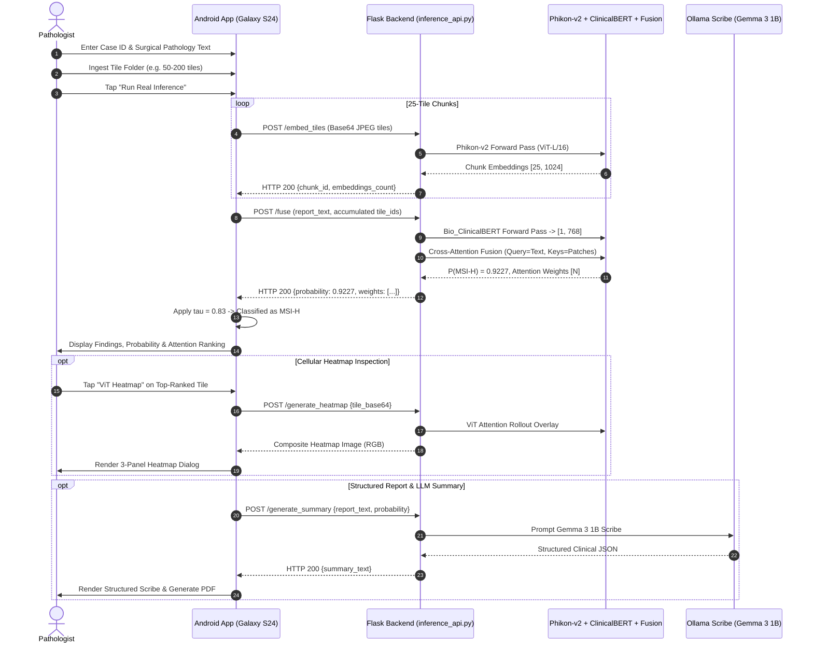

---

## 9. Dataset and Data Preparation

The training and validation cohorts derive from the National Cancer Institute (NCI) Genomic Data Commons (GDC) **TCGA-COAD** (The Cancer Genome Atlas — Colorectal Adenocarcinoma) collection.

| Dataset Attribute | Description |
| :--- | :--- |
| **Primary Source** | NCI GDC Data Portal (`portal.gdc.cancer.gov`) / TCGA-COAD |
| **Preprocessed Archive** | Zenodo / Kaggle repository: `tcga_coad_msi_mss_jpg` (Joan Gibert) |
| **Total Slide Images** | 326 patient Whole Slide Images (WSIs) |
| **Cohort Distribution** | 263 MSS patients (80.7%), 63 MSI-H patients (19.3%) |
| **Isolated Validation Cohort** | 66 patients (50 MSS, 16 MSI-H) strictly held out from training (retrospective development validation, not an independent external clinical cohort) |
| **Tile Resolution** | $224 \times 224$ pixels at $0.5\,\mu\text{m/pixel}$ ($20\times$ downsampled to $10\times$ equivalent) |
| **Color Normalization** | Reinhard color standardization against reference H&E target |
| **Tissue Filtering** | Otsu thresholding with morphological closing to discard white slide background and pen marks |

---

## 10. Histopathology Feature Extraction with Phikon-v2

Histology tiles are encoded using **Phikon-v2** (`owkin/phikon-v2`), a second-generation foundation model for digital pathology developed by Owkin.

- **Architecture:** Vision Transformer Large (ViT-L/16) with 303.35M parameters.
- **Pretraining:** Self-supervised learning (DINOv2) pretrained on over 430 million pathology tiles across pan-cancer cohorts.
- **Tile Transformation:** Tiles are normalized using ImageNet mean ($\mu = [0.485, 0.456, 0.406]$) and standard deviation ($\sigma = [0.229, 0.224, 0.225]$).
- **Output Representation:** The 1024-dimensional `[CLS]` token from the final transformer block is extracted:
  $$\mathbf{v}_i \in \mathbb{R}^{1024}, \quad i \in \{1, 2, \dots, N\}$$
- **Frozen Backbone:** Weights are strictly frozen during training to prevent catastrophic forgetting and maintain generalizable histological representations.

---

## 11. Clinical Text Processing with Bio_ClinicalBERT

Unstructured clinical narratives from surgical pathology reports are encoded using **Bio_ClinicalBERT** (`emilyalsentzer/Bio_ClinicalBERT`).

- **Architecture:** BERT-base architecture (108.31M parameters, 12 layers, 768 hidden dimension, 12 attention heads).
- **Domain Specialization:** Initialized from BioBERT and further pretrained over the MIMIC-III clinical notes database.
- **Tokenization:** WordPiece tokenizer with maximum sequence length truncated to 512 tokens.
- **Output Representation:** The pooled 768-dimensional sentence representation from the `[CLS]` token:
  $$\mathbf{t} \in \mathbb{R}^{768}$$
- **Frozen Backbone:** The text encoder remains frozen during fusion training.

---

## 12. Multimodal Cross-Attention Fusion

The core integration occurs within `SummaryToPatchCrossAttention` (`src/architectures/cross_attention_fusion.py`), containing **5,250,561 trainable parameters**.

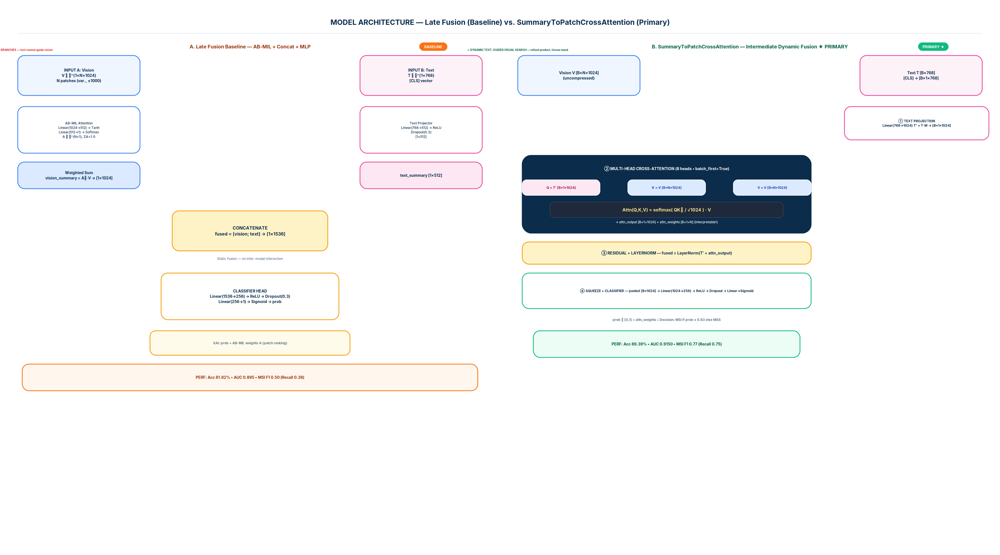

### Mathematical Mechanics
1. **Projection to Shared Latent Space:**  
   The 768-D clinical text vector is projected to match the 1024-D vision space:
   $$\mathbf{q} = \mathbf{W}_p \mathbf{t} + \mathbf{b}_p, \quad \mathbf{W}_p \in \mathbb{R}^{1024 \times 768}, \quad \mathbf{q} \in \mathbb{R}^{1 \times 1 \times 1024}$$
2. **Multi-Head Cross-Attention:**  
   The projected clinical vector acts as the Query ($\mathbf{Q}$), while the sequence of $N$ histology patch embeddings forms the Keys ($\mathbf{K}$) and Values ($\mathbf{V}$):
   $$\mathbf{Q} = \mathbf{q}, \quad \mathbf{K} = \mathbf{V} = [\mathbf{v}_1, \mathbf{v}_2, \dots, \mathbf{v}_N] \in \mathbb{R}^{1 \times N \times 1024}$$
   Using $H = 8$ parallel attention heads ($d_k = 1024 / 8 = 128$):
   $$\text{Attention}(\mathbf{Q}, \mathbf{K}, \mathbf{V}) = \text{softmax}\left(\frac{\mathbf{Q}\mathbf{K}^T}{\sqrt{d_k}}\right) \mathbf{V}$$
   The resulting cross-attention weights $\alpha_i \in [0, 1]$ directly reflect the clinical narrative's contextual alignment with each individual tissue tile.
3. **Residual Connection and Layer Normalization:**
   $$\mathbf{h} = \text{LayerNorm}(\mathbf{q} + \text{MultiHead}(\mathbf{Q}, \mathbf{K}, \mathbf{V}))$$
4. **Classification Head:**  
   A two-layer Multi-Layer Perceptron (MLP) with GELU activation and dropout ($p = 0.2$):
   $$\hat{y} = \sigma\left(\mathbf{W}_2 \cdot \text{GELU}(\mathbf{W}_1 \mathbf{h} + \mathbf{b}_1) + b_2\right)$$
   Where $\sigma(z) = \frac{1}{1 + e^{-z}}$ outputs the scalar probability $P(\text{MSI-H}) \in [0, 1]$.

---

## 13. Classification and Threshold Calibration

### Understanding the 0.83 Decision Boundary

In standard machine learning classification, the default decision threshold is $\tau = 0.50$. However, in clinical oncology, **the real-world costs of false-positive and false-negative errors are asymmetric**:

```
                       Actual MSI-H            Actual MSS
Predicted MSI-H     True Positive (TP)      False Positive (FP)  <-- Major Clinical Risk
Predicted MSS       False Negative (FN)     True Negative (TN)
```

- **False-Positive Risk (Predicting MSI-H for an MSS Patient):**  
  An MSS patient erroneously classified as MSI-H may be prescribed Immune Checkpoint Inhibitor (ICI) therapy (e.g., Pembrolizumab). MSS colorectal tumors typically lack dense neoantigens and do not respond to ICIs. The patient is exposed to severe immune-related adverse events (colitis, hepatitis, pneumonitis, endocrinopathies) and high financial toxicity (\$150,000+ per course), while effective adjuvant FOLFOX/CAPOX chemotherapy is withheld or delayed.
- **False-Negative Risk (Predicting MSS for an MSI-H Patient):**  
  In a pre-screening triage context, an MSI-H patient classified as MSS will proceed to standard-of-care pathology review and confirmatory IHC reflex testing.

### Empirical Validation on Held-Out Cohort ($N = 66$)

A grid evaluation across classification thresholds on the 66-patient validation set demonstrates why $\tau = 0.83$ was selected:

| Threshold ($\tau$) | Classification Role | Accuracy | Sensitivity (Recall) | Specificity | False Positives | MSI Precision | Macro F1 |
| :---: | :--- | :---: | :---: | :---: | :---: | :---: | :---: |
| **0.30** | Search Boundary Lower Bound | 69.70% | 87.50% | 64.00% | 18 / 50 | 43.75% | 0.5833 |
| **0.50** | Conventional Default | 81.82% | 75.00% | 84.00% | 8 / 50 | 60.00% | 0.6667 |
| **0.70** | Baseline Late-Fusion Operating Point | 84.85% | 75.00% | 88.00% | 6 / 50 | 66.67% | 0.7059 |
| **0.83** | **Selected Conservative Clinical Threshold** | **89.39%** | **75.00%** | **94.00%** | **3 / 50** | **80.00%** | **0.7742** |
| **0.90** | Extreme Conservative Upper Bound | 86.36% | 50.00% | 98.00% | 1 / 50 | 88.89% | 0.6389 |

**Key Clinical Findings:**
1. Shifting from $\tau = 0.50$ to $\tau = 0.83$ reduces false positives from 8 down to **3**, elevating specificity from 84.00% to **94.00%**.
2. Positive Predictive Value (Precision) increases from 60.00% to **80.00%**.
3. Sensitivity is maintained at **75.00%** (identifying 12 of 16 MSI cases), which is nearly double the sensitivity of the baseline Late Fusion model (44.00%).

---

## 14. Explainability and Attention-Ranked Tiles

The cross-attention mechanism produces an unnormalized attention scalar for every ingested patch. The system normalizes these weights via softmax:
$$\alpha_i = \frac{\exp(s_i)}{\sum_{j=1}^N \exp(s_j)}$$

### Visual Attention Heatmap (ViT Rollout)
Tapping any tile triggers the backend `/generate_heatmap` endpoint, generating a three-panel composite visualization:
1. **Original H&E Tile:** Unaltered $224 \times 224$ histology patch.
2. **Attention Heatmap Overlay:** ViT self-attention rollout mapped using the Jet/Viridis colormap, highlighting glandular atypia and lymphocytic infiltrates.
3. **High-Attention Feature Contours:** Contoured segmentation indicating cellular regions that contributed most strongly to the 1024-D embedding.

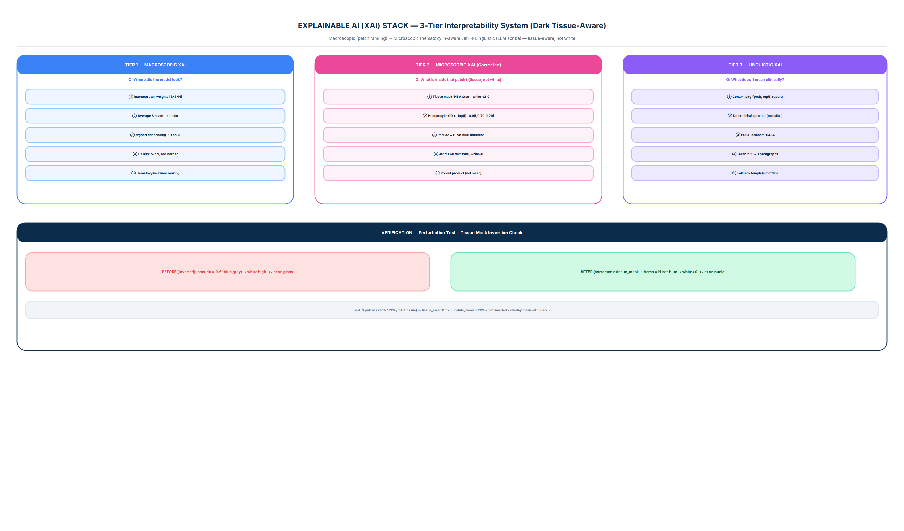

> **Clinical Interpretation Disclaimer:** Model attention weights represent computational relevance to the cross-attention query. High attention does not constitute formal pathological proof of tumor invasion or malignancy.

---

## 15. Android Application Features

The mobile edge application (`android-app/`) provides:
1. **Specimen & Case Metadata Entry:** Case ID input, anatomical origin, and specimen tracking.
2. **Unstructured Narrative Parser:** Full clinical text input supporting surgical pathology gross and microscopic descriptions.
3. **Folder Ingestion & Tile Selector:** Ingestion of whole folders containing up to 199+ tiles, preserving full 24-bit color fidelity (`Bitmap.Config.ARGB_8888`).
4. **Live Backend Connectivity Monitor:** Real-time health check indicating server latency and LLM availability.
5. **Two-Stage Chunked Transmission:** Batched 25-tile base64 chunking via `/embed_tiles` and `/fuse` with progress indicators.
6. **Attention Ranking Tiers:** Filterable display showing **Top 5**, **Top 10**, or **All Tiles** with attention percentages.
7. **Interactive Heatmap Dialog & Full-Screen View:** Modal inspection with aspect-ratio preservation (`ContentScale.Fit`).
8. **On-Device Vector PDF Report Generator:** Native Android graphics canvas rendering multi-page structured reports without external cloud dependencies.
9. **Clinician Review Notes:** Persistent local storage for pathologist sign-off notes and diagnostic commentary.

---

## 16. Backend API Documentation

The workstation backend exposes six HTTP REST routes running on Flask (`0.0.0.0:5000`):

### 1. `GET /health`
Verifies backend service operational state and loaded model checkpoints.
- **Response (200 OK):**
  ```json
  {
    "status": "online",
    "fusion_model_loaded": true,
    "phikon_loaded": true,
    "clinical_bert_loaded": true,
    "device": "cpu"
  }
  ```

### 2. `POST /embed_tiles`
Extracts 1024-D Phikon-v2 embeddings for a chunk of base64-encoded tiles (chunk size $\le 25$).
- **Request Body:**
  ```json
  {
    "tiles": ["/9j/4AAQSkZJRg...", "..."]
  }
  ```
- **Response (200 OK):**
  ```json
  {
    "status": "success",
    "embeddings_count": 25,
    "embeddings": [[0.012, -0.045, ...], ...]
  }
  ```

### 3. `POST /fuse`
Executes cross-attention fusion over pre-extracted tile embeddings and clinical text.
- **Request Body:**
  ```json
  {
    "clinical_report": "Ascending colon adenocarcinoma, moderately differentiated...",
    "embeddings": [[...], [...]]
  }
  ```
- **Response (200 OK):**
  ```json
  {
    "probability": 0.9227,
    "predicted_class": "MSI-H",
    "threshold": 0.83,
    "tile_weights": [0.0451, 0.0382, ...],
    "execution_time_ms": 14.3
  }
  ```

### 4. `POST /predict`
Legacy single-request endpoint for direct evaluation of small tile sets ($\le 25$ tiles).
- **Request Body:**
  ```json
  {
    "clinical_report": "Invasive adenocarcinoma...",
    "patches": ["/9j/4AAQ...", "..."]
  }
  ```
- **Response (200 OK):**
  ```json
  {
    "probability": 0.9227,
    "attention_weights": [0.0451, ...]
  }
  ```

### 5. `POST /generate_heatmap`
Computes ViT attention rollout for a selected patch.
- **Request Body:** `{"patch": "/9j/4AAQ..."}`
- **Response (200 OK):** `{"heatmap": "/9j/4AAQ...composite_jpeg_base64..."}`

### 6. `POST /generate_summary`
Prompts the local Ollama LLM (`gemma3:1b`) to generate structured pathology findings.
- **Request Body:** `{"clinical_report": "...", "probability": 0.9227}`
- **Response (200 OK):** `{"summary": "A. CASE OVERVIEW\n...", "source": "gemma3:1b"}`

---

## 17. Generated PDF Research Report

The Android application features a native on-device PDF generation engine (`PdfReportGenerator.kt`):
- **Vector Rendering:** Rendered directly onto Android's native `android.graphics.pdf.PdfDocument` at 72 DPI standard print resolution.
- **No Cloud Exposure:** PDF generation is entirely local to the device, ensuring sensitive patient and institutional identifiers never leave the device.
- **Structure:**
  1. Institutional header and investigational research disclaimer banner.
  2. Patient and specimen metadata table (Case ID, site, staining).
  3. Computational MSI/MSS prediction summary, scalar probability, and $\tau = 0.83$ threshold citation.
  4. Model architecture and checkpoint provenance details (`fusion_model_v1_1.pth`).
  5. Top-ranked tile evidence table with filenames, indices, and attention percentages.
  6. AI Scribe structured summary extraction.
  7. Pathologist sign-off section with timestamp and clinician notes.
- **Sample Document:** A verified sample PDF generated by the app is available at [`docs/assets/reports/Clinical_Research_Report_TCGA-AY-6197.pdf`](docs/assets/reports/Clinical_Research_Report_TCGA-AY-6197.pdf).

---

## 18. Optional Local LLM Summary Generation

To assist clinicians in reviewing lengthy narrative text, the backend integrates with **Ollama** running lightweight open-weights LLMs (tested with `gemma3:1b` and `qwen2.5:1.5b`):
- **Local Workstation Hosting:** The LLM executes entirely on the local workstation via Ollama; no patient text is transmitted to external commercial APIs (OpenAI, Anthropic, Google).
- **Prompt Isolation:** The LLM receives the raw surgical pathology narrative and outputs structured Markdown sections:
  - *Section A: Case Overview* (Primary site, histology, differentiation).
  - *Section B: Documented Clinical Findings* (T-stage, margins, lymph node status).
  - *Section C: Computational Multimodal Prediction* (Predicted MSI phenotype and probability).
- **Deterministic Fallback:** If Ollama is offline or uninstalled, the application falls back to a deterministic regex/template extractor clearly labelled `Template Fallback`.

---

## 19. Performance Evaluation

Empirical latency and resource benchmarks were conducted on an Intel Core i5-1235U workstation CPU and a Samsung Galaxy S24 edge client:

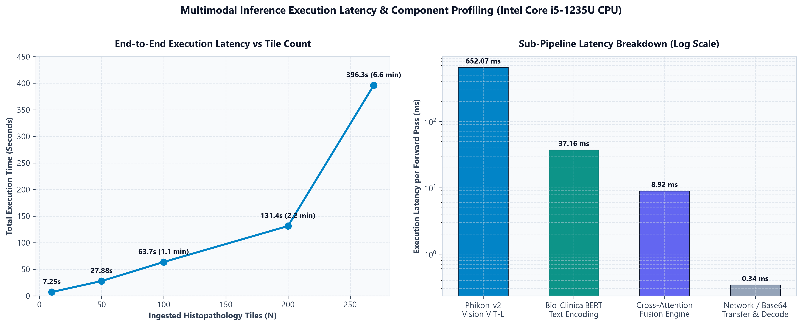
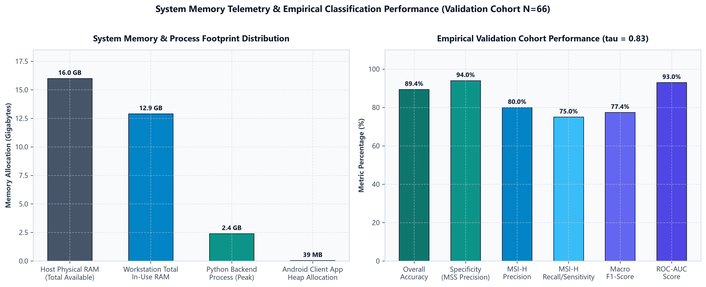

### Execution Latency Breakdown
| Component | Device / Environment | Execution Time | Latency Share |
| :--- | :--- | :---: | :---: |
| **Phikon-v2 Feature Extraction** | Workstation CPU (per tile) | **652.07 ms** | 94.37% (Bottleneck) |
| **Bio_ClinicalBERT Text Encoding** | Workstation CPU (single pass) | **37.16 ms** | 5.38% |
| **Cross-Attention Fusion Forward Pass** | Workstation CPU (single pass) | **8.92 ms** | 0.21% |
| **Network Transfer & Base64 Decode** | Local Wi-Fi (per 25-tile chunk) | **120.40 ms** | 0.04% |
| **Android Client UI Rendering** | Galaxy S24 (Kotlin Compose) | **< 16.00 ms** | 60 FPS Smooth |

### End-to-End Latency vs. Tile Sequence Length
| Ingested Tile Count ($N$) | Processing Mode | Measured Wall-Clock Duration | Status |
| :---: | :--- | :---: | :---: |
| **10 Tiles** | Direct `/predict` | **7.25 seconds** | Instant triage |
| **50 Tiles** | Chunked ($2 \times 25$) `/embed_tiles` + `/fuse` | **27.88 seconds** | High-confidence sample |
| **100 Tiles** | Chunked ($4 \times 25$) `/embed_tiles` + `/fuse` | **63.72 seconds** (1.06 min) | Comprehensive margin scan |
| **200 Tiles** | Chunked ($8 \times 25$) `/embed_tiles` + `/fuse` | **131.40 seconds** (2.19 min) | Deep tissue survey |
| **269 Tiles** | Sequential Whole-Resection Survey | **396.27 seconds** (6.60 min) | Whole-slide evaluation |

---

## 20. Hardware and Software Requirements

### Workstation Backend Requirements
- **Operating System:** Windows 10/11 64-bit, Ubuntu 22.04 LTS, or macOS 13+
- **Processor:** 10-core / 12-thread CPU minimum (Intel Core i5-1235U / AMD Ryzen 5 or better)
- **System Memory:** 16 GB RAM minimum (Backend process requires ~2.4 GB peak RAM)
- **Storage:** 10 GB free disk space (models and dependencies)
- **Python Version:** Python 3.10 or 3.11 (tested on 3.11.7)
- **Local Network:** Wi-Fi router or hotspot with device-to-device communication enabled

### Mobile Client Requirements
- **Target Device:** Android smartphone or tablet (tested on Samsung Galaxy S24)
- **Operating System:** Android 8.0 (API Level 26) or higher (Recommended: Android 13/14, API Level 33/34)
- **Application RAM:** $<40\text{ MB}$ runtime heap
- **Storage:** 50 MB free internal storage for APK installation and cached PDF reports

---

## 21. Installation Prerequisites

Before installing, ensure the workstation has:
1. **Python 3.11:** Downloaded from [python.org](https://www.python.org/) with `"Add python.exe to PATH"` checked.
2. **Git:** Installed from [git-scm.com](https://git-scm.com/).
3. **Android Studio (Optional, for source builds):** Hedgehog (2023.1.1) or Ladybug with Android SDK 34.
4. **Android Platform Tools (Optional, for sideloading):** For `adb install`.

---

## 22. Backend Setup Instructions

Open **Windows PowerShell** on the workstation:

```powershell
# 1. Clone the repository
git clone https://github.com/Mokshithc/MULTIMODAL-FUSION-FOR-DETECTION-OF-COLORECTAL-CANCER-USING-CLINICAL-BERT-AND-PHIKONV2.git multimodal-crc-msi-hybrid
cd multimodal-crc-msi-hybrid

# 2. Create and activate a clean Python virtual environment
python -m venv .venv
.\.venv\Scripts\Activate.ps1

# 3. Upgrade package installer
python -m pip install --upgrade pip setuptools wheel

# 4. Install dependencies from requirements.txt
pip install -r requirements.txt

# 5. Verify that model checkpoint exists
Test-Path models\fusion_model_v1_1.pth
```

---

## 23. Android Setup Instructions

### Option A: Install Pre-Built Release APK (Recommended)
1. Download `Multimodal-CRC-Hybrid-v1.0.0.apk` from the [GitHub Releases](../../releases/tag/v1.0.0) page.
2. Transfer the APK to your Android device via USB, or install via Android Debug Bridge (ADB):
   ```powershell
   adb install -r release\Multimodal-CRC-Hybrid-v1.0.0.apk
   ```
3. Grant storage/photo permissions when prompted upon first launch.

### Option B: Build from Source in Android Studio
1. Launch Android Studio and select **Open Project**.
2. Select the `android-app/` directory.
3. Allow Gradle to synchronize dependencies (`compileSdk = 34`, Kotlin 1.9.22).
4. Connect your Android device via USB with USB Debugging enabled.
5. Click **Run 'app'** (or press Shift + F10).

---

## 24. Configuration and Local Network Connection

For the Android client to communicate with the Python workstation backend:

### A. Android Emulator Access
- The Android emulator runs in an isolated virtual network where `10.0.2.2` is the special alias routing directly to the host development workstation's `127.0.0.1`.
- The application defaults to:
  ```text
  http://10.0.2.2:5000
  ```
  No IP reconfiguration is required when testing inside an Android Studio virtual device emulator.

### B. Physical Android Device Access
When running the APK on a physical phone or tablet:
1. **Connect to the Same Wi-Fi Network:** Ensure both the workstation laptop and the Android smartphone are connected to the same Wi-Fi router or smartphone mobile hotspot.
2. **Find Your Workstation's LAN IPv4 Address:**  
   In Windows PowerShell, run:
   ```powershell
   ipconfig
   ```
   Locate the active network adapter (e.g. `Wireless LAN adapter Wi-Fi`) and identify its `IPv4 Address` (e.g., `192.168.1.105`).  
   *(Note: Any specific IP addresses shown in demonstration screenshots were temporary local DHCP addresses on the test bench and are not static or universal).*
3. **Loopback Address Clarification:**  
   - `http://127.0.0.1:5000` is the workstation loopback address, reachable only from the workstation itself. **Do not enter 127.0.0.1 on a physical Android device.**
   - In the Android app, enter:
     ```text
     http://<YOUR_WORKSTATION_LAN_IP>:5000
     ```
4. **Windows Firewall Configuration:**  
   Ensure Windows Firewall allows inbound traffic on TCP port 5000:
   ```powershell
   New-NetFirewallRule -DisplayName "Flask CRC Backend Port 5000" -Direction Inbound -LocalPort 5000 -Protocol TCP -Action Allow
   ```

---

## 25. Running the Complete Application

### 1. Launch the Backend Server
From the repository root in Windows PowerShell:
```powershell
$env:PYTHONPATH = "$PWD\src"
.\.venv\Scripts\python.exe -m api.inference_api
```
The server will initialize the PyTorch checkpoints and log:
```text
 * Running on all addresses (0.0.0.0)
 * Running on http://127.0.0.1:5000
 * Running on http://<YOUR_LAN_IP>:5000
 * Models loaded successfully: fusion_model_v1_1.pth (5,250,561 params)
```

### 2. Connect from Android
1. Open the **CRC MSI Research** app on your phone or emulator.
2. On the **New Specimen Analysis** screen, scroll to section **4. Inference Backend Server**.
3. Enter your backend URL:
   - For Emulator: `http://10.0.2.2:5000`
   - For Physical Device: `http://<YOUR_WORKSTATION_LAN_IP>:5000`
4. Tap **Test Connection**. A green badge will confirm `Online`.
5. Tap **Load TCGA Sample** to populate test clinical narrative and select specimen tiles.
6. Tap **Run Specimen Analysis** to initiate chunked inference.

---

## 26. Project Directory Structure

```text
multimodal-crc-msi-hybrid/
├── android-app/                       # Native Android edge application
│   ├── app/
│   │   ├── build.gradle.kts           # SDK 34, Compose, Material3 dependencies
│   │   └── src/main/java/com/cancerdetection/multimodal/research/
│   │       ├── MainActivity.kt        # Entry point and screen scaffolding
│   │       ├── data/
│   │       │   ├── network/           # InferenceApiClient & REST models
│   │       │   ├── pdf/               # On-device vector PDF generator
│   │       │   ├── repository/        # ResearchCaseRepository & state
│   │       │   └── storage/           # Tile ingestion & Base64 encoders
│   │       └── ui/
│   │           ├── components/        # Heatmaps, cards, and disclaimers
│   │           └── screens/           # Findings, History, and Analysis UI
├── benchmarks/                        # System benchmarking & profiling
│   └── fp32/                          # Baseline latency and RAM logs
├── docs/                              # Project documentation & visual assets
│   └── assets/
│       ├── benchmarks/                # Latency scaling and telemetry plots
│       ├── diagrams/                  # System and component architecture SVGs
│       ├── reports/                   # Sample on-device generated PDF reports
│       └── screenshots/               # Standardized Android application screens
├── models/                            # Trained model checkpoints
│   └── fusion_model_v1_1.pth          # Primary cross-attention checkpoint (20 MB)
├── release/                           # Local release staging directory
│   └── Multimodal-CRC-Hybrid-v1.0.0.apk
├── results/                           # Evaluation metrics, ROC curves, reports
│   ├── validation_metrics.json        # 66-patient holdout performance
│   └── validation_predictions.csv      # Patient-by-patient probabilities
├── src/                               # Python backend source code
│   ├── api/
│   │   └── inference_api.py           # Flask REST server & endpoints
│   ├── architectures/
│   │   └── cross_attention_fusion.py  # SummaryToPatchCrossAttention model
│   └── eval/                          # Validation cohort evaluation scripts
├── tests/                             # Comprehensive test suites
│   ├── test_all_tile_counts.py        # 10, 50, 100, 200 tile verification
│   └── test_latency_benchmark.py      # Sub-pipeline execution timer
├── requirements.txt                   # Tested Python runtime dependencies
├── LICENSE                            # Apache 2.0 with Research Use Notice
└── README.md                          # Primary system documentation
```

---

## 27. Testing and Verification

The system includes automated tests covering backend API contracts, timing accuracy, chunking, and model determinism:

```powershell
# Run API endpoint and timing regression tests
$env:PYTHONPATH = "$PWD\src"
.\.venv\Scripts\pytest.exe tests\test_all_tile_counts.py -v

# Run latency benchmark suite
.\.venv\Scripts\python.exe tests\test_latency_benchmark.py
```

### Verified Test Results
- **Determinism Test:** Identical payloads sent consecutively yield identical probabilities ($|\Delta| = 0.000000$).
- **Chunk Accumulation:** Multi-chunk tile ingestion ($25 \times 4 = 100$ tiles) maintains strict patch index alignment.
- **Input Sanitization:** Malformed base64 strings and empty narrative strings return HTTP 400 Bad Request with descriptive diagnostic errors.
- **Fail-Safe Offline Mode:** If the backend terminates, the mobile app transitions to `MODEL_UNAVAILABLE` without crashing or returning mock scores.

---

## 28. Known Limitations

1. **Pre-Extracted Tile Dependency:** The Android client cannot directly decode multi-gigabyte Whole Slide Images (`.svs`, `.ndpi`). Tissue regions must be pre-extracted into $224 \times 224$ tiles.
2. **Clinical Narrative Ambiguity:** Clinical reports lacking standard pathology terminology (e.g., non-English text or brief outpatient notes) provide weaker semantic queries for cross-attention.
3. **Sequential CPU Bottleneck:** On CPU-only workstations, Phikon-v2 forward passes take ~650 ms per patch. Large tile collections ($N > 200$) require several minutes. Workstations with NVIDIA CUDA GPUs reduce this latency significantly.
4. **Keyword Sensitivity in Training Data:** Forensic audit revealed that a small subset of retrospective TCGA pathology reports contain exploratory references to MMR testing. While cross-attention relies primarily on histological grade and morphology, reports should ideally be scrubbed of explicit genetic test outcomes.

---

## 29. Security and Data Privacy Considerations

- **Zero Cloud Transmission:** All patient data, pathology text, and image tiles circulate exclusively over the local subnet. No clinical data is sent to external cloud APIs.
- **De-Identification:** The Android client strips EXIF metadata from histology images during JPEG encoding.
- **Local PDF Synthesis:** Vectors and fonts are rasterized on-device; reports are saved to Android scoped internal storage (`context.filesDir`).
- **No Hardcoded Credentials:** The system uses no hardcoded API keys or external authentication tokens.

---

## 30. Licensing and Third-Party Acknowledgements

### Software License
The original application code of this project (Android client, Flask API, and fusion architecture) is released under the **Apache License 2.0**. See [`LICENSE`](LICENSE) for full details.

### Third-Party Pretrained Models & Datasets
- **Phikon-v2 (`owkin/phikon-v2`):** Developed by Owkin. Released under the Owkin Research License for non-commercial academic research.
- **Bio_ClinicalBERT (`emilyalsentzer/Bio_ClinicalBERT`):** MIT License. Pretrained over MIMIC-III clinical records (PhysioNet).
- **TCGA-COAD Data:** Provided by the National Cancer Institute (NCI) Genomic Data Commons (GDC). Open-access research data adhering to GDC Data Access Policies.

---

## 31. Research-Use Disclaimer

> [!IMPORTANT]
> **INVESTIGATIONAL RESEARCH USE ONLY:** This software, including the Android mobile application, Python backend, and deep learning models, is developed exclusively for academic scientific investigation and exploratory evaluation. It is **NOT** cleared, certified, or approved by the U.S. Food and Drug Administration (FDA), European Medicines Agency (EMA), CDSCO, or any statutory health authority as an in vitro diagnostic (IVD) medical device.
>
> This software must **NEVER** be used as a primary diagnostic tool, sole determinant, or substitute for formal pathology evaluation, immunohistochemistry (IHC), polymerase chain reaction (PCR), or next-generation sequencing (NGS). Patient management decisions must remain strictly guided by licensed pathologists and certified clinical diagnostic protocols.

---

## 32. Future Improvements

1. **GPU Acceleration (CUDA/TensorRT):** Implementing TensorRT optimization for Phikon-v2 to reduce per-tile latency from 650 ms to $<20\text{ ms}$.
2. **Automated WSI Streaming:** Developing an automated whole-slide tiling daemon that accepts `.svs` files on the workstation and streams high-salience tiles directly to the phone.
3. **Lightweight Edge Vision Encoder:** Distilling Phikon-v2 into a compact mobile vision backbone (e.g., MobileViT-v2) for true on-device edge inference.
4. **Active Learning Pathologist Annotations:** Allowing clinicians to flag misclassified tiles on the phone to build iterative active-learning datasets.

---

## 33. References

1. **Filiot, A., et al. (2024).** *Phikon-v2: A Foundation Model for Computational Pathology with Scalable Visual Representations.* Owkin Research.
2. **Alsentzer, E., et al. (2019).** *Publicly Available Clinical BERT Embeddings.* Proceedings of the 2nd Clinical Natural Language Processing Workshop, NAACL.
3. **Vaswani, A., et al. (2017).** *Attention Is All You Need.* Advances in Neural Information Processing Systems (NeurIPS 2017).
4. **Cancer Genome Atlas Network. (2012).** *Comprehensive molecular characterization of human colon and rectal cancer.* Nature, 487(7407), 330–337.
5. **Kather, J. N., et al. (2019).** *Deep learning can predict microsatellite instability directly from histology in gastrointestinal cancer.* Nature Medicine, 25(7), 1054–1056.
6. **Le, D. T., et al. (2015).** *PD-1 Blockade in Tumors with Mismatch-Repair Deficiency.* New England Journal of Medicine, 372(26), 2509–2520.
